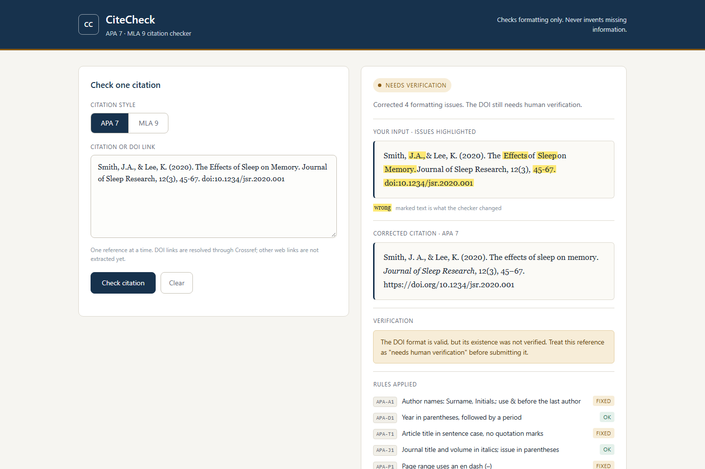

# CiteCheck — APA 7 / MLA 9 citation checker

CiteCheck checks the **formatting** of one reference at a time (or a list, one per line) against
APA 7 or MLA 9 rules.
It corrects what it can, shows exactly which style rule it applied, asks for missing required
fields instead of inventing them, and flags unverifiable DOIs as *"needs human verification"*.
It checks and corrects citations; it does not write content for you.



AILT9019 · AI Literacy II · group project

## Quick start

No build step, no API key, no server needed. The app is plain HTML/CSS/JS.

| Option | How | Works for |
|--------|-----|-----------|
| Double-click `index.html` | Opens directly in a modern browser, no install | Everyone — the fastest way |
| GitHub Pages | Enable Pages in Settings → Pages → main branch, then open the assigned URL | Anyone, no install |
| Local server (optional) | `start-server.bat` (Windows) or `python -m http.server 8000`, then open <http://localhost:8000> | If you prefer serving it |

The DOI verification feature calls the Crossref API, so it needs an internet connection.
Everything else (parsing, rule checks, refusals) works fully offline. DOI verification runs when
the whole input is a single DOI link — `https://doi.org/…`, `http://`, `dx.doi.org`, `doi:10.…`,
or a bare `10.…` DOI. A DOI written inside a citation is formatted but not resolved.

## Example input and expected output

Paste this into the box, keep **APA 7** selected, and press **Check citation**:

```
Smith, J.A., & Lee, K. (2020). The Effects of Sleep on Memory. Journal of Sleep Research, 12(3), 45-67. doi:10.1234/jsr.2020.001
```

Expected output — corrected citation:

```
Smith, J. A., & Lee, K. (2020). The effects of sleep on memory. Journal of Sleep Research, 12(3), 45–67. https://doi.org/10.1234/jsr.2020.001
```

with status **"Needs verification"** (the DOI format is valid but not verified) and four rules
marked **fixed**: APA-A1 (initials spacing), APA-T1 (title case), APA-P1 (en dash), APA-DOI1
(`doi:` prefix → full link).

`10.1234/jsr.2020.001` is a documentation-only DOI (the `10.1234` prefix is a test prefix), so it
does **not** resolve — it is used here to show the "needs verification" state. For a live check that
returns verified metadata, use `https://doi.org/10.1038/nature14539`.

Full demo cases, including the missing-field and refusal paths: see [`docs/TEST_EVIDENCE.md`](docs/TEST_EVIDENCE.md).

## What it does

- Parses a pasted citation and checks it against the APA 7 / MLA 9 rule set
  ([`docs/STYLE_RULES.md`](docs/STYLE_RULES.md))
- Outputs the corrected citation **plus the rule IDs** that were applied (fixed / ok per rule)
- Asks an explicit question for any missing required field — it never invents data
- Refuses clearly: unsupported styles, out-of-scope requests ("write my essay"), and single-line
  input longer than 600 characters
- Resolves a whole-input DOI link (`https://doi.org/...`, `doi:10...`, or a bare `10...` DOI)
  through the Crossref API and marks it verified
- Flags unverified DOIs as *"needs human verification"*; URLs are carried through unchecked and
  flagged, not opened

## How to check its result

1. Open the app (see Quick start).
2. Paste a citation (e.g. the example above), pick APA 7 / MLA 9, press **Check citation**.
3. The result shows **your input with the erroneous parts highlighted in yellow**, the corrected
   citation, and a rule ID explaining every change in "Rules applied".
4. Run the automated tests — either way you should see **8 passed, 0 failed**
   ([`docs/TEST_EVIDENCE.md`](docs/TEST_EVIDENCE.md) lists every input, expected and actual result):
   - **In the browser (no install needed):** double-click `tests.html`
   - **With Node.js:** `node tests.mjs`

## Reference list mode

Paste several citations, one per line, and the checker processes each one individually. Each result shows its own status, corrected citation (when complete), rules applied, and any AI-generated flag. The overall status reflects the worst result across all items.

## AI-generated flag

References with unverifiable DOIs, generic journal names, or no source link are flagged as likely AI-generated or fabricated. Each flagged reference comes with a verification checklist:

1. Confirm the DOI resolves to a real source.
2. Confirm the journal or publisher exists and matches this article.
3. Check the authors and title against the original publication.

Treat flagged references as "needs human verification" before submitting.

## Known limitations

Honest scope — see [`docs/TEST_EVIDENCE.md`](docs/TEST_EVIDENCE.md) for the full list:

- Non-DOI web links are not resolved or verified (browser CORS): a bare web link shows
  "Link not supported yet" and the citation text must be pasted instead
- APA sentence-casing preserves acronyms, internal-capital words, and common proper nouns (for
  example "Hong Kong"), but an unlisted proper noun may still be lower-cased
- Only journal articles and books have style rules; videos, datasets, and legal sources are passed
  through unchecked, not refused

## Roadmap

1. Non-DOI link metadata extraction (needs a small server-side helper to bypass CORS)
2. "Likely AI-generated" flag with a verification checklist — **done**
3. Small reference-list mode (one citation per line) — **done**
4. Ship the checker as a skill file for agent environments — **done** (`citecheck.skill.md`)

## Project structure

```
core.js                  parsing + rule engine (no DOM, testable)
app.js                   UI logic, Crossref DOI resolution
index.html / styles.css  single-page interface
tests.html               run the 8 automated tests in a modern browser
tests.mjs                same tests for Node (node tests.mjs)
start-server.bat/.sh     optional local server
citecheck.skill.md       agent skill file for chat environments
docs/                    test evidence + style-rule mapping
assets/                  screenshot
```
